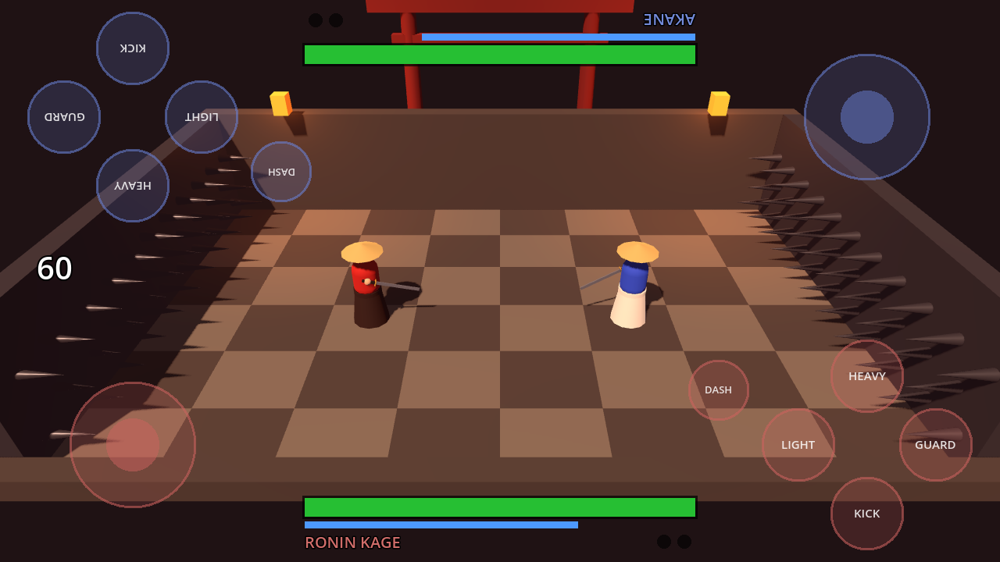

# Katana Arena: playable prototype

Step 2 of the plan in `../game-design-doc.md`: one arena (Spike Courtyard), two samurai
(Ronin Kage and Akane), the full core katana moveset, 2 players on one phone, Duel mode
(best of 3), blood, hit-stop and placeholder sounds. Godot 4.3 or newer.



## Try it on a computer (fastest)

1. Install Godot 4.3+ (standard version, not .NET) from godotengine.org.
2. Open Godot, click **Import**, pick this folder's `project.godot`, then press **Play** (F5).
3. Menu: **2 Players**, **VS CPU** or **CPU VS CPU**. The buttons underneath switch the camera
   (Arena or Classic side view), the touch layout and the gore level.

Keyboard: Player 1 uses WASD to move, F light, G heavy, H kick, T guard, R dash.
Player 2 uses the arrow keys and the numpad: 1 light, 2 heavy, 3 kick, 5 guard, 0 dash.
Any gamepad works too: stick or d-pad, X light, Y heavy, A kick, B dash, RB or RT guard.
To see the touch controls on a computer, run with `-- --touch` (the mouse acts as a finger).

## Put it on a phone

**Android** (from Windows, Mac or Linux):
1. In Godot: *Editor > Manage Export Templates > Download and Install*.
2. Install Android Studio once (it brings the Android SDK and Java), then in Godot set
   *Editor Settings > Export > Android*: the SDK path and the Java SDK path.
3. *Project > Export > Add... > Android*, keep the defaults, and click **Export Project** to get an `.apk`.
   Or turn on USB debugging on the phone, plug it in and press the Android icon at the top
   right of the editor to install and run it straight away.

**iPhone** needs a Mac with Xcode and a free Apple developer account:
*Project > Export > Add... > iOS*, export, open the generated Xcode project and run it on the phone.

## How 2 players share one phone

Lay the phone flat between you, long edges facing each player. Player 1 (red) gets the bottom half,
Player 2 (blue) the top half, turned to face them. Each half has a floating stick on the left and the
buttons on the right, and each player's health bar sits at their own edge. Pushing the stick away from
you always moves your samurai away from you. If you'd rather sit side by side holding the phone
sideways, switch **Controls: Side by side** in the menu.

## Moves

| Input | Move |
|---|---|
| Stick | Run. Double-tap a direction to sprint (uses stamina). |
| Light | Fast slash, 6 damage. Tap again to chain up to 3. |
| Heavy | Slow slash, 14 damage. Breaks through light slashes. **Hold** to charge an overhead cleave (25). |
| Kick | 4 damage and a big shove. Kick someone into the spike walls for +30. |
| Guard | Blocks hits from the front and costs stamina. Press it just before a hit lands to **parry** and stun the attacker. Run out of stamina and your guard breaks. |
| Dash | Quick invulnerable dodge, short cooldown. No direction = backstep. |
| Light + Heavy | Special: rising slash, 17 damage, costs stamina. |
| Kick + Guard | Throw, 12 damage. Beats a blocking opponent. |

Every attack auto-turns toward the nearest enemy (soft lock-on).

## What was checked

- The project imports cleanly in Godot 4.3 (headless) with no script errors.
- 12 scripted combat tests pass: run `godot --headless --path . -- --combat-tests`.
  They cover hit damage, the 3-hit chain, block, parry, guard break, throw vs guard, heavy armour
  vs light, charged overhead, special, dash invulnerability, spike walls and sprint.
- Full CPU vs CPU duels play to the end (`-- --autotest --seed=N`).
- Screenshots of the arena camera, Classic side view, touch layout and menu were rendered from the
  game in `docs/screenshots/`.
- **Not yet checked on a real phone**: how the touch controls feel, frame rate on mobile, and audio.

## Layout

```
project.godot
data/            move_table.gd (all frame data and tuning), fighter_table.gd (character stats)
scripts/
  autoload/      game_settings, event_bus (hit/kill/round events), sfx, announcer (priority queue)
  combat/        fighter.gd (state machine + placeholder model), blood_fx.gd
  core/          main.gd (screens), duel_match.gd (fixed 60 Hz step, rounds, hit-stop, hazards)
  input/         InputFrame + sources: touch, keyboard, gamepad, CPU, scripted (tests)
  arena/         spike_courtyard.gd
  camera/        arena_camera.gd (angled zoom camera or Classic side view, screen shake)
  ui/            touch_pad.gd, hud.gd, main_menu.gd, results_screen.gd
  tests/         combat_tests.gd
audio/sfx/       placeholder sounds, generated by tools/make_sfx.py (no samples, no MK4 audio)
```

Built so steps 3 and 4 can plug in: fighters only see `InputFrame`s (a network input source slots in
next to touch and gamepad), the match steps the simulation on a fixed 60 Hz tick (ready to run on a
Wi-Fi host), gameplay events go through `EventBus`, and callouts go through the `Announcer` queue
(the voiced lines replace the placeholder sting in step 4).

## Not in this prototype (later steps)

Wi-Fi play for 4 and 8, character select, other modes, kill streaks and multi-kills (step 3);
the voiced announcer, real sound set, music and finishers (step 4); weapon throwing, dismemberment,
real character models and the other arenas (after that).
